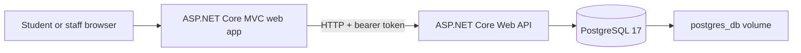

# CampusFix

CampusFix is a small campus maintenance reporting app for CLDV6212. A student registers, reports a fault and follows its status. A staff account views reports and marks work as in progress or resolved.

New to Docker or the project? Start with the [plain-language guide and completion checklist](docs/BEGINNER_GUIDE.md).

**Status: the application runs locally in Docker; assignment work remains.** The website, API and PostgreSQL containers were built and checked on 8 October 2026, including saved data after container recreation. GitHub Actions, live deployment, group contribution history, supporting research and the presentation still need completion.

## Problem and intended users

The proposed problem is that students may struggle to report campus faults and find out whether they have been addressed. The intended users are students and campus maintenance staff. This is a **hypothesis to investigate**, not a finding from interviews. The app gives each fault a location, category, description and visible status.

Before submission, replace this paragraph with supporting research: credible sources and/or actual conversations, the current reporting process, recurring difficulties and why these features respond to them. The lecturer also permits a realistic business scenario. Interviews are one possible research method, not a compulsory method in the brief. Do not invent statistics or participant comments. See [the group checklist](docs/GROUP_CHECKLIST.md).

## What is included

- Student registration and sign-in; a separate staff role.
- Create a fault report, list your reports, search/filter them and view details.
- Staff access to all reports and status updates.
- Validation, hashed passwords, JWT API authentication and role/ownership checks.
- Swagger API documentation at `/swagger`.
- Separate web and API Dockerfiles, PostgreSQL Compose storage and a GitHub Actions pipeline.

This first version deliberately has no photo uploads, email notifications, staff assignment, password recovery or full status audit history. It creates the initial database schema automatically; add EF Core migrations before evolving an existing populated database.

## Architecture



Both applications target .NET 10. Shared request/response models live in `CampusFix.Contracts`. The browser uses the web app; the web app calls the API on the server. Database access belongs to the API. Local Docker uses `http://api:8080/` between the containers. The Windows development launcher uses a SQLite file for convenience; the required multi-container setup uses PostgreSQL.

| Component | Location | Local Docker address |
|---|---|---|
| Web app | `src/CampusFix.Web` | <http://localhost:5080> |
| API and Swagger | `src/CampusFix.Api` | <http://localhost:5081/swagger> |
| Shared models | `src/CampusFix.Contracts` | No service |
| API tests | `tests/CampusFix.Api.Tests` | Test runner |
| PostgreSQL | Compose `db` service | Internal network only |

## Run locally

Use Visual Studio with Docker Desktop for everyday coding and the assignment's Docker demonstration. The **CampusFix in Docker** green Run workflow was verified in Visual Studio on 8 October 2026. It started the website and API with the PostgreSQL database; browser sign-in displayed the previously saved resolved report. The optional start/stop buttons were also verified.

1. Open Docker Desktop, use Linux containers and wait for its engine to run.
2. Open `CampusFix.sln` in Visual Studio. In Solution Explorer, right-click **docker-compose** and choose **Set as Startup Project** if it is not already selected.
3. Select **CampusFix in Docker** beside the green Run button, then click Run or press **F5**. Visual Studio builds the Docker images, starts the database, API and MVC website together, and opens <http://localhost:5080>. Missing private `.env` settings are generated; existing settings are preserved. The first build and download of Microsoft's container debugging tools can take several minutes.
4. After editing code, save, stop the Visual Studio run and click Run again to rebuild the containers with your changes.

The website sends requests to the API, and the API saves accounts and reports in PostgreSQL. PostgreSQL data persists in the named `postgres_db` Compose volume, separately from its container.

When finished, click Visual Studio's red **Stop** button. In this configured Visual Studio 2026 Compose run, that button was tested and stopped all three services while retaining the database volume. Open **Docker Desktop > Containers** to confirm the **campusfix** containers are stopped. If they are already stopped, no further Stop click is needed. If any remain running, such as after using a separate launcher or Ctrl+F5, use the group's **Stop** control. To close Docker Desktop before gaming too, right-click its icon beside the taskbar clock and choose **Quit Docker Desktop**. Stopping containers keeps your accounts and reports.

Optional alternatives need no terminal: **Start-Docker.cmd** builds and starts the Docker version, and **Stop-Docker.cmd** removes this project's containers while keeping the database volume. Stop Visual Studio's run first if using these buttons. **Setup-Docker.cmd** prepares private settings separately and preserves an existing `.env`. **Start CampusFix.cmd** and **Stop-CampusFix.cmd** run the earlier Windows/SQLite version with separate local data under `.local`.

Read [Getting started](docs/GETTING_STARTED.md) for staff credentials and troubleshooting. Keep using GitHub Desktop for repository work. Do not delete the database volume or use `docker compose down --volumes` unless you intend to erase local Docker accounts and reports.

## Configuration

`.env` is used by Compose and is excluded from Git. The Windows launcher keeps separate generated settings in `.local`; it does not depend on `.env`.

| Variable | Use |
|---|---|
| `POSTGRES_PASSWORD` | Required in `.env`; use a unique generated hexadecimal value. |
| `JWT_KEY` | Required in `.env`; random signing key of at least 32 characters. |
| `SEED_STAFF_EMAIL` | Optional initial staff email; supply with the password. |
| `SEED_STAFF_PASSWORD` | Optional initial staff password, 12–128 characters. |
| `DbProvider` | API setting: `Postgres` in Compose/hosting; `Sqlite` only in Development or Testing. |
| `ConnectionStrings__CampusFix` | API database connection string; Compose supplies it using the database password. |
| `Jwt__Key` | API signing key; Compose maps `JWT_KEY` to it. |
| `Jwt__Issuer`, `Jwt__Audience` | API token settings; both default to `CampusFix`. |
| `Api__BaseUrl` | Web app's API address; Compose sets `http://api:8080/`. |
| `Cookies__RequireSecure` | Web setting; Compose disables secure-only cookies for loopback HTTP. Keep enabled for live HTTPS hosting. |
| `ASPNETCORE_FORWARDEDHEADERS_ENABLED` | Hosting-only proxy setting; see the trust requirements in the deployment guide. |
| `Seed__StaffEmail`, `Seed__StaffPassword` | API names for the initial staff settings, mapped from `.env` in Compose. |
| `TEST_POSTGRES_CONNECTION` | Test-only PostgreSQL connection; supplied by CI. |

An existing seed email is left unchanged on startup. Changing the seed password does not reset an existing account or grant an existing student staff access.

## Tests and delivery pipeline

```powershell
dotnet test CampusFix.App.slnf
```

`CampusFix.sln` includes the Visual Studio Docker Compose project. `CampusFix.App.slnf` selects just the .NET application and test projects for command-line builds and CI. Tests use a local test database unless `TEST_POSTGRES_CONNECTION` is supplied. The CI workflow supplies a disposable PostgreSQL service. It builds and tests the application projects, scans source/dependencies, builds both Docker images, scans them and checks that the containers start. See `.github/workflows/ci.yml`.

The five current tests are API integration tests, not unit tests. The brief specifically names unit tests or automated Postman tests for CI. Add focused unit tests or an automatically executed Postman collection before marking that exact requirement complete; keep the integration tests as additional coverage.

Verified locally on 7 October 2026: the solution built without warnings or errors, all five API integration tests passed against SQLite, and the NuGet dependency audit reported no known vulnerable packages. Browser checks covered student registration, report submission, staff sign-in and status updates, a phone-sized layout, and report persistence after stopping and restarting both services.

Verified with Docker Desktop on 8 October 2026: both application images built, all three Compose services started, and both health endpoints responded successfully. Checks against the running PostgreSQL-backed API covered registration, report creation, staff sign-in/status updates, denied unauthenticated access, denied student status updates, student report isolation and Swagger. The stop button removed the containers without deleting the database volume; restarting restored the student account and resolved report. Browser sign-in displayed that saved report through the MVC website. These were additional workflow checks, not a run of the five integration tests against PostgreSQL. GitHub Actions, image security scans and hosted deployment remain unverified.

Also verified on 8 October: clicking **CampusFix in Docker** in the actual Visual Studio interface started the web and API containers alongside the healthy PostgreSQL container. Student sign-in and the saved resolved report worked through both the API and MVC website. Clicking Visual Studio's red Stop button then left no running project containers: web and API were exited, the database was exited, and `campusfix_postgres_db` remained present. A second green Run restarted all three services, both health checks passed, and the student account and resolved report remained saved. Red Stop was checked again and left all three stopped. The dependency audit, including the container tooling packages, found no known vulnerable NuGet packages in the four application/test projects. This does not verify the GitHub pipeline or public hosting.

Authentication attempts are rate-limited at the API. In this version, users of the MVC website share the web server's API limit (30 attempts in five minutes); allow the window to reset if a class demo reaches it. This is a small demonstration app, not a configured campus production system.

The Trivy checks fail on HIGH or CRITICAL findings, including vulnerabilities without a known fix. New upstream findings can therefore block a previously passing build; investigate and document the result instead of treating a green badge as a security guarantee. The workflow also checks secrets and configuration. Action version tags and image tags should be reviewed and updated; Dependabot is configured for NuGet and Actions.

Deployment hooks run only after all checks succeed on a push to `main`, and only when both Render secrets are configured. Hook acceptance means a deployment was requested; it does not prove that the live deployment finished successfully. See [deployment setup](docs/DEPLOYMENT.md).

## Live deployment and group

**Live URL: not deployed.** Add the tested public URL here after deployment.

| Member | Name / student number | Actual contributions and PR links |
|---|---|---|
| 1 | To complete | To complete |
| 2 | To complete | To complete |
| 3, if registered | To confirm | To complete |

Each member must make and review real contributions through their own GitHub account. Do not use these placeholders or generated files as evidence that members have already contributed. The assignment requires every group member to participate in the presentation; discuss any registered member's absence with the lecturer.

The authoritative brief is the [CLDV6212 assignment repository](https://github.com/SMahabeer07/ICE-Task-CLDV6212). This scaffold still needs the evidence and checks in [GROUP_CHECKLIST.md](docs/GROUP_CHECKLIST.md).
